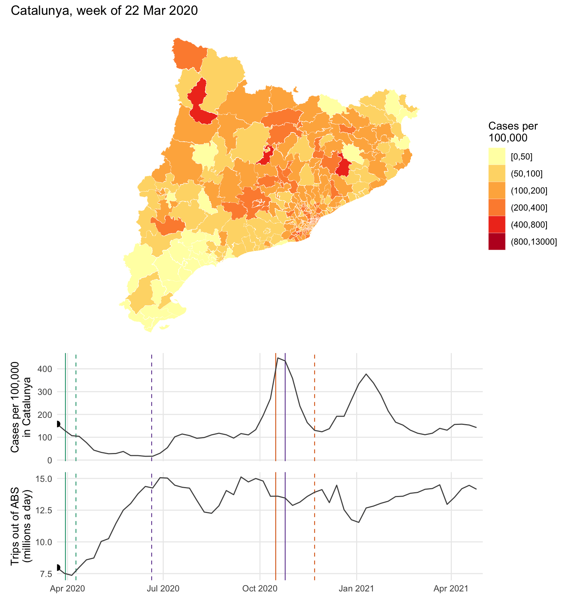

# Neighbours by boundaries or by trips

Endemic-epidemic (`hhh4`) models of weekly COVID-19 cases in the 374 basic health areas (ABS) of Catalunya,
22 March 2020 to 1 May 2021. The same model is fitted with neighbours defined by shared boundaries, by trip orders
and by trip shares, and the three are compared by in-sample fit, one-week-ahead forecasts and how the fitted cases
split between the endemic, autoregressive and neighbour components.

**Report:** <https://iprincegh.github.io/covid-end-epi-neighbours/>

## Data

- **Cases**: BSC COVID-19 Flow-Maps (Ponce-de-Leon and Pontes 2024,
  [doi:10.5281/zenodo.12207212](https://doi.org/10.5281/zenodo.12207212)).
- **Trips**: MITMA, reprojected to ABS (Niraula and Oppong Boakye 2026,
  [doi:10.5281/zenodo.23737062](https://doi.org/10.5281/zenodo.23737062)).
- **Population**: CatSalut.
- **Temperature**: AEMET.
- **Restrictions**: BOE and DOGC decrees.

## Citation

Oppong Boakye, P. (2026). *Neighbours by boundaries or by trips: endemic-epidemic models of COVID-19 in
Catalunya*. https://github.com/iprincegh/covid-end-epi-neighbours
